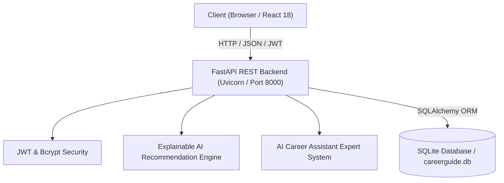

# System Architecture & Technical Specifications

## 1. Overview
The **AI CareerGuide** application follows a decoupled client-server architecture consisting of:
- **Presentation Layer (Frontend)**: React 18 with TypeScript and Tailwind CSS, bundled with Vite 5.
- **Application & Logic Layer (Backend)**: FastAPI asynchronous REST API with Pydantic v2 data validation.
- **Data & Storage Layer**: SQLite relational database managed by SQLAlchemy 2.0 ORM.
- **Artificial Intelligence Engine**: Explainable AI (XAI) multi-factor weighted scoring and student competency profile generation.

---

## 2. Database Schema (Entity-Relationship)

### Tables
1. **users**: Primary credentials table (`id`, `name`, `email`, `password_hash`, `role`, `created_at`).
2. **student_profiles**: Extended student attributes (`id`, `user_id`, `age`, `education_level`, `stream`, `current_class`, `percentage`, `academic_details`, `goals`, `created_at`, `updated_at`).
3. **skills**: Catalog of core competencies (`id`, `name`, `category`).
4. **student_skills**: Student proficiency self-ratings 1–5 (`id`, `student_id`, `skill_id`, `rating`).
5. **questions**: Assessment questions catalog (`id`, `category`, `question_text`, `question_type`, `options`, `weight`, `order_num`).
6. **assessments**: Student assessment session records (`id`, `student_id`, `started_at`, `completed_at`, `status`, `total_score`, `profile_snapshot`).
7. **answers**: Responses for an assessment session (`id`, `assessment_id`, `question_id`, `answer`).
8. **careers**: Comprehensive career profiles (`id`, `name`, `category`, `description`, `education`, `skills`, `interests`, `work_style`, `roadmap`, `typical_responsibilities`, `recommended_subjects`, `beginner_skills`, `advanced_skills`, `related_courses`, `related_job_roles`, `salary_range`, `job_outlook`).
9. **recommendations**: Generated compatibility outcomes (`id`, `assessment_id`, `career_id`, `compatibility_score`, `explanation`).

---

## 3. Core API Endpoints

### Authentication
- `POST /api/auth/register` — Register a student account and initialize profile.
- `POST /api/auth/login` — Authenticate credentials and issue JWT bearer token.
- `GET /api/auth/me` — Retrieve active authenticated user information.

### Student Profile & Skills
- `GET /api/student/profile` — Fetch student profile, completion percentage, and assessment status.
- `PUT /api/student/profile` — Update academic details, CGPA, stream, and career ambitions.
- `GET /api/student/skills` — Fetch list of 15 core skills with user ratings.
- `POST /api/student/skills` — Update specific skill rating.

### Assessment Flow
- `GET /api/questions` — Retrieve all 30 ordered assessment questions.
- `POST /api/assessment/start` — Start a new assessment session or resume active session.
- `POST /api/assessment/answer` — Auto-save student response for a question.
- `POST /api/assessment/submit` — Submit assessment and trigger Explainable AI engine.
- `GET /api/assessment/latest` — Fetch latest completed assessment with recommendations and radar scores.
- `GET /api/assessment/history` — Fetch student assessment timeline for historical comparison.
- `GET /api/assessment/{id}` — Fetch specific assessment run details.

### Careers Catalog
- `GET /api/careers` — Search and filter careers by category, skill, or alphabetical sort.
- `GET /api/careers/{id}` — Retrieve full career details, 4-phase roadmap, and personalized skill gaps.

### AI Assistant & Admin
- `POST /api/chat/ask` — Context-aware AI assistant providing personalized career advice.
- `GET /api/admin/dashboard` — Platform metrics, career recommendation distributions, and top interests.
- `POST|PUT|DELETE /api/admin/careers` — Career catalog management.
- `POST|PUT|DELETE /api/admin/questions` — Assessment question management.
- `GET /api/admin/students` — Registered students directory.
